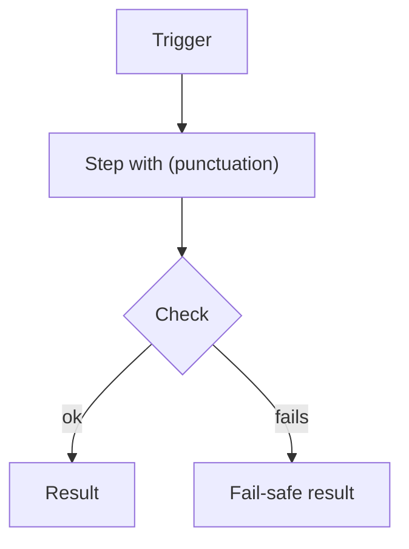

# ADR-NNNN: <short decision title>

<!-- Template for every ADR: scripts/ai-sdlc/generate-adr.mjs puts this file in
     its prompt, and .claude/skills/write-adr points interactive sessions here.
     Delete all HTML comments when filling it in.

     Rules:
     - Main body (title through Alternatives) fits on one or two screens:
       aim for <= 120 lines. Long material that an issue explicitly requires
       inside the ADR (a table inventory, a test matrix) goes to an appendix.
     - Tables over paragraphs. A paragraph is for reasoning, not for listing.
     - One Mermaid diagram when the decision has a real flow, boundary or
       before/after; none for a one-line policy. Quote node labels that contain
       punctuation: A["withBypass(reason, fn)"]. Keep it under ~15 nodes and
       render it before merge (docs/adr/README.md).
     - Facts about this repo carry a file:line, or are marked "unverified".
       Do not write about what the author could or could not run or read.
     - The ADR records what is decided and why. File lists, migrations and
       per-slice steps belong in the spec; link to it instead of repeating it.
     - Status stays Proposed; a human reviewer sets Accepted. -->

- Status: Proposed
- Area: <area>
- Date: YYYY-MM-DD
- Refs: #NNN; spec docs/specs/NNNN-slug.md

> **Decision:** <one to three sentences: what is chosen and the main reason.
> A reader who stops here knows the outcome.>

## Context

<!-- 5-10 lines: the problem, what makes it hard (constraints, existing code
     with file:line), and what happens if nothing is decided. -->

## Decision

<!-- Lead with a table of the decided aspects, then short subsections only
     where a choice needs reasoning that does not fit a cell. -->

| Aspect   | Choice   | Why                     |
| -------- | -------- | ----------------------- |
| <aspect> | <choice> | <reason, or constraint> |

## Consequences

<!-- At most five one-line bullets per group. -->

**Positive**

- <effect>

**Negative / accepted**

- <cost or new failure mode, and why it is accepted>

**Risks and follow-ups**

- <open item, owner or slice that resolves it>

## Alternatives

| Option   | Why not chosen |
| -------- | -------------- |
| <option> | <one line>     |

<!-- Optional appendices, only for content the issue requires in the ADR:

## Appendix A: <name>

| ... | ... |
-->
