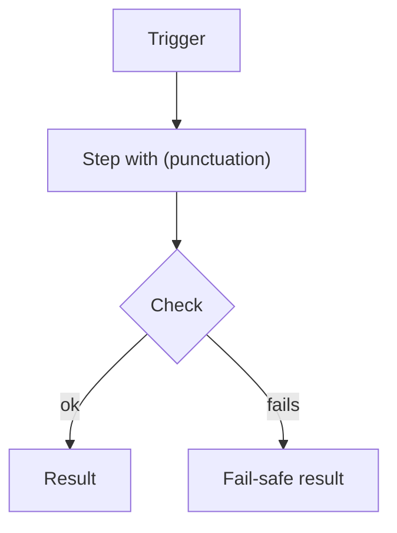

# ADR-NNNN: <short decision title>

<!-- ADR template. Used by scripts/ai-sdlc/generate-adr.mjs and the write-adr
     skill. Delete these comments when filling it in.

     - Main body (title to Alternatives): one or two screens, about 120 lines.
       Long material a spec requires inside the ADR goes in an appendix.
     - Tables for lists and comparisons; paragraphs only for reasoning.
     - One Mermaid diagram if there is a real flow, boundary or before/after.
       Quote labels with punctuation: A["withBypass(reason, fn)"]. Under ~15
       nodes. Render it before merge (docs/adr/README.md).
     - Repo facts carry path:line, with the path from the repository root
       (packages/backend/src/db/client.ts:603, not client.ts:603), or are
       marked "unverified". No notes about what the author could or could
       not run.
     - Decide what and why here; file lists and per-slice steps belong in the
       spec. Link to it.
     - Status stays Proposed; a human sets Accepted. -->

- Status: Proposed
- Area: <area>
- Date: YYYY-MM-DD
- Refs: #NNN; spec docs/specs/NNNN-slug.md

> **Decision:** <one to three sentences: what is chosen and the main reason.
> A reader who stops here knows the outcome.>

## Context

<!-- 5-10 lines: the problem, what makes it hard (constraints, existing code
     with file:line), and what happens if nothing is decided. -->

## Decision

<!-- Lead with a table of the decided aspects, then short subsections only
     where a choice needs reasoning that does not fit a cell. -->

| Aspect   | Choice   | Why                     |
| -------- | -------- | ----------------------- |
| <aspect> | <choice> | <reason, or constraint> |

## Consequences

<!-- At most five one-line bullets per group. -->

**Positive**

- <effect>

**Negative / accepted**

- <cost or new failure mode, and why it is accepted>

**Risks and follow-ups**

- <open item, owner or slice that resolves it>

## Alternatives

| Option   | Why not chosen |
| -------- | -------------- |
| <option> | <one line>     |

<!-- Optional appendices, only for content the issue requires in the ADR:

## Appendix A: <name>

| ... | ... |
-->
