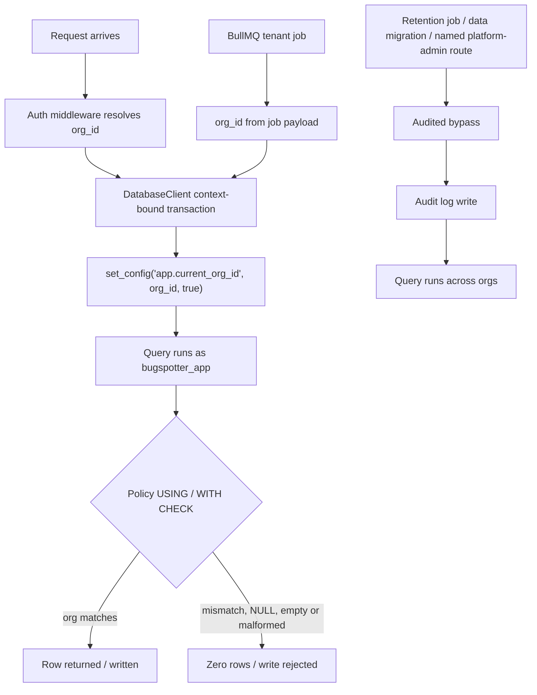

# Spec: RLS Slice 1 — ADR and rollout spec for Postgres row-level security

Linked issue: Refs #451
ADR: docs/adr/0045-postgres-row-level-security.md

**Files touched:** `docs/adr/0045-postgres-row-level-security.md`, `docs/adr/README.md`, `docs/specs/0451-rls-rollout-slices-2-7.md`
**Blocking prerequisites:** none

## Problem

Tenant isolation today is enforced entirely in application code — every repository method in `packages/backend/src/db/repositories` is responsible for adding its own `organization_id`/`project_id` filter, and nothing in `packages/backend/src/db/migrations` defines Postgres-level policies. The backend's runtime Postgres role is also the migration-owning role, so even if a policy were added naively it would be silently bypassed (table owners bypass RLS by default). A single missed `WHERE` clause in a repository or a new query path that forgets the filter is a cross-tenant data leak with no second line of defense. This slice produces no runtime change; it produces a ratified ADR (role model, context propagation, bypass paths, policy shape, table inventory, self-hosted behavior, rollout order and per-slice rollback) plus a spec that breaks slices 2-7 of #450 into reviewable, ≤6-file slices, so that they can be implemented and reviewed independently without re-litigating the design each time.

## Out of scope

- Writing or applying any migration that adds `ENABLE ROW LEVEL SECURITY`, `CREATE POLICY`, or a new runtime role — that is slices 2-7.
- Any change to `packages/backend/src/db/client.ts`, `transaction.ts`, or repository call sites — slice 1 is docs-only.
- The intelligence service's database — it is a separate database per docs/adr/README.md Era 4 (ADR-0027/0028) and is out of scope for this platform-DB RLS effort entirely.
- Any component outside `bugspotter-public` (e.g. the SDK, extension, landing, MCP repos per the architecture index) — none of this issue's scope touches those repos.
- Classifying tables added after this ADR is accepted — slice 1 inventories tables that exist **today**; new tables follow the ADR's classification rules and are enforced by the slice 7 coverage guard, not retroactively added to the ADR.

## Constraints

1. **Role model.** The ADR must decide the split between the migration-owner role (`bugspotter_owner` per #450) and a `NOSUPERUSER NOBYPASSRLS` runtime role (`bugspotter_app` per #450), and specify the exact `GRANT`/`ALTER DEFAULT PRIVILEGES` on the `application`, `saas`, and `public` schemas — a table owner or superuser silently bypasses RLS, so this is a correctness precondition for every later slice.
2. **Context propagation.** Tenant context uses transaction-scoped `set_config('app.current_org_id', ..., true)` (the `true` "local" flag, not session-level `SET`) because `docker-compose.yandex.yml` fronts Postgres with PgBouncer in transaction-pooling mode on port 6432 — session-level `SET` would leak context across pooled connections reused by different requests.
3. **Where the context-bound client lives.** `DatabaseClient` (`packages/backend/src/db/client.ts:125`) owns the pool and exposes `transaction(callback)` (`client.ts:603`, issues `BEGIN` on a checked-out client); `packages/backend/src/db/transaction.ts` exports only types (`TransactionContext`, `TransactionCallback`). The ADR must therefore place the `set_config` call in `DatabaseClient` (inside `transaction()` and in a context-bound variant for non-transactional `query()` paths), so repositories in `packages/backend/src/db/repositories` do not all change in the same slice (purely-additive rollout per CLAUDE.md).
4. **Tenant jobs keep tenant context; bypass is narrow.** BullMQ jobs (`packages/message-broker/src/adapters/bullmq/worker-host.ts`) that act for one organization run as the runtime role with `app.current_org_id` set from the job payload — they are **not** a bypass path (#450 Testing item 7: "worker jobs only see the org from their payload"). The audited bypass (separate role or policy branch — the ADR decides and justifies) is reserved for operations that are cross-organization by design, and the ADR must enumerate each one with its audit-log requirement:
   - retention jobs — `RetentionService` iterates every project via `this.db.projects.findAll()` (`packages/backend/src/retention/retention-service.ts:82`);
   - migrations that read or write data in a `FORCE ROW LEVEL SECURITY` table (DDL itself is unaffected);
   - platform-admin routes — handlers guarded by `requirePlatformAdmin()` (`packages/backend/src/api/middleware/auth/authorization.ts:39`, re-exported from `middleware/auth.ts`). Today that guard appears in `admin.ts`, `admin-integrations.ts`, `admin-intelligence.ts`, `admin-jobs.ts`, `admin-organization-requests.ts`, `admin-organizations.ts`, `integrations.ts`, `invoice-billing.ts`, `jobs.ts`, `organizations.ts`, `retention.ts`, `users.ts` under `packages/backend/src/api/routes`; the ADR names which of those routes actually need cross-org reads (#450: bypass "reachable only from the routes the ADR names").
5. **Policy shape.** `USING` + `WITH CHECK` on every policy (not `USING` alone, which permits cross-tenant writes), `FORCE ROW LEVEL SECURITY` so table owners are also subject to the policy, project-scoped tables resolve the org through `projects`, and fail-closed behavior when `app.current_org_id` is NULL, empty, or not a valid UUID (deny, not allow-all).
6. **Complete table inventory.** The ADR classifies **every** table created in `packages/backend/src/db/migrations/*.sql` (49 today) as org-scoped, project-scoped, or global, with a one-line reason for each global table (#450 names `users`, `permissions`, `system_config`, `legal_entities`, `email_verification_tokens` as global). `grep -liE "organization_id|project_id"` only helps find tenant-scoped candidates; it is not the completeness check — `email_verification_tokens` (`019_email_verification.sql:29`) contains neither column.
7. **Self-hosted mode uses the same code path.** Per #450, self-hosted keeps RLS on with the single org as context; skipping RLS is not an option. Self-hosted rows today carry `organization_id IS NULL` in `application.projects` and `application.bug_reports` (`001_initial_schema.sql:1560-1568`: "NULL = self-hosted mode"), which fail-closed policies would hide. The ADR must specify how the single org is created or resolved and how those NULL rows are backfilled, and that backfill must ship before the first policy slice.
8. **Ordering.** Every policy slice (4, 5, 6) is blocked by slices 2 and 3; slice 3 must deliver request context, worker payload context, the named bypass paths, and the self-hosted single-org backfill, each with its tests. A deployment between slices must never have policies enabled while a legitimate code path still runs without context.
9. **Slice limits and additivity.** Each of slices 2-7 touches 6 files or fewer (a slice that cannot fit is split, e.g. 3a/3b, with the split recorded in the rollout spec) and only rejects queries that were already cross-tenant bugs (per #450), never a same-tenant query that worked before.
10. **Slice plan matches #450.** Slices 2-7 keep #450's scope: 2 runtime role split, 3 tenant context plumbing, 4-6 policy batches A/B/C with #450's table lists, 7 CI coverage guard failing the build when any table with an `organization_id` or `project_id` column lacks `relrowsecurity AND relforcerowsecurity`.
11. **Exact tests per slice.** For each slice the rollout spec lists the #450 Testing items it must add (by number and name), the concrete scenarios and assertions (e.g. item 3: no context, empty string, malformed UUID; item 4: commit, rollback, and thrown error with pool size 1; item 5: N=200 interleaved requests), and the target test file path. Per #450, testing applies to every slice: regression (8), self-hosted (9) and, for policy slices, performance (10) and migration up/down (11) are repeated per slice, not deferred to the end.
12. **Per-slice rollback.** The ADR and rollout spec give recovery steps for each slice in dependency-safe order: policy slices roll back with an `ALTER TABLE ... DISABLE ROW LEVEL SECURITY` migration (policies stay defined); context plumbing is reverted only after every policy that depends on it is disabled; the role switch rolls back by pointing `DATABASE_URL` at the owner role and restarting `api`/`worker` (no data change); the coverage guard rolls back by reverting its CI job.
13. **Testing Strategy names all 11 categories.** The ADR's Testing Strategy section names all 11 test categories from #450 explicitly by name (not summarized), so AC verification is a literal string match, not a judgment call.
14. **Follow-up issues.** Each slice 2-7 follow-up issue is filed with its `Blocking prerequisites` field pointing at the slice(s) it depends on (all depend on slice 1 / this ADR being `Accepted`; 4-6 also depend on 2 and 3; 7 depends on 4-6).

## Acceptance criteria

- [ ] `docs/adr/0045-postgres-row-level-security.md` exists, follows the MADR shape (Context → Decision → Consequences → Alternatives) used by other entries in `docs/adr/README.md`, and its `Status:` field reads `Accepted` — verified by Test case A.
- [ ] The PR that sets `Status: Accepted` is approved by the repository owner before merge (#451: "merged with `Status: Accepted` after owner review") — a manual check of the PR's review state, called out in Verification below.
- [ ] The ADR contains a Mermaid flowchart showing the request → transaction → `set_config` → policy-check flow, a worker path that sets context from the job payload under the runtime role, and a separate audited bypass path for each named cross-org operation — verified by Test case B.
- [ ] The ADR's Testing Strategy section contains all 11 test category names from #450 verbatim — verified by Test case C.
- [ ] `docs/adr/README.md` has a new Era 7 row for ADR-0045 (consistent with the existing table format) — verified by Test case D.
- [ ] `docs/specs/0451-rls-rollout-slices-2-7.md` exists and, for each of slices 2-7 (scoped as in #450), lists: the files touched (explicit count ≤6), the migration file(s) it adds, its blocking prerequisites, the exact #450 tests it adds (item numbers, scenarios, assertions, test file paths), and its rollback steps — verified by Test case E.
- [ ] The ADR's `### Table inventory` subsection classifies every table created in `packages/backend/src/db/migrations/*.sql` as `org-scoped`, `project-scoped`, or `global`, and every `global` row has a non-empty reason — verified by Test case F.
- [ ] Each of the 6 follow-up GitHub issues for slices 2-7 is filed with a non-empty `Blocking prerequisites` field — this is a manual filing step tracked outside this repo's test suite, called out explicitly in Verification below since it cannot be grep-checked from a local clone.

## Changes

### `docs/adr/0045-postgres-row-level-security.md`

New file. Outline of required content (full prose is the deliverable of implementing this issue, not reproduced here):

```md
# ADR-0045: Postgres row-level security

Status: Accepted

## Context

<!-- app-only isolation today; runtime role = superuser/table owner; PgBouncer transaction
     pooling on :6432; self-hosted rows have NULL organization_id -->

## Decision

1. Role model: `bugspotter_owner` keeps DDL rights and owns objects; `bugspotter_app` is
   NOSUPERUSER NOBYPASSRLS with DML grants and ALTER DEFAULT PRIVILEGES on `application`,
   `saas`, `public`.
2. Context propagation: `set_config('app.current_org_id', $1, true)` issued as the first
   statement of every transaction from `DatabaseClient.transaction()` (client.ts) and of a
   context-bound wrapper for non-transactional `query()` paths.
3. Background jobs: tenant jobs (worker-host.ts) run as `bugspotter_app` with context from
   the job payload.
4. Bypass model: retention (`RetentionService`, all projects), data migrations on FORCE RLS
   tables, and the platform-admin routes named here use the audited bypass (separate role or
   policy branch, decided here), with an audit-log write on every use.
5. Policy shape: USING + WITH CHECK on every policy, FORCE ROW LEVEL SECURITY, project-scoped
   tables resolve org via `projects`, fail-closed on NULL/empty/malformed app.current_org_id.
6. Table inventory: see the `### Table inventory` subsection below.
7. Self-hosted mode: same code path; the single org is created/resolved and NULL
   organization_id rows are backfilled before the first policy slice.
8. Rollout order and per-slice rollback: references docs/specs/0451-rls-rollout-slices-2-7.md.

### Table inventory

<!-- one row per table created in packages/backend/src/db/migrations/*.sql;
     Scope is exactly one of org-scoped / project-scoped / global; Reason is required for global -->

| Table   | Scope          | Reason            |
| ------- | -------------- | ----------------- |
| <table> | org-scoped     |                   |
| <table> | project-scoped |                   |
| <table> | global         | <one-line reason> |

## Testing Strategy

bypass-proof; per-table CRUD matrix; fail-closed; pooled-connection leak; concurrency;
role assertions; bypass paths; full-suite regression as the runtime role; self-hosted
mode; performance budget (p95 within 10%); migration up/down on prod-shaped data.

## Consequences

## Alternatives considered
```



### `docs/adr/README.md`

Add a row to the Era 7 table (append after the ADR-0044 row).

```md
| [0045](0045-postgres-row-level-security.md) | Postgres row-level security - role model, context propagation, bypass paths | public |
```

### `docs/specs/0451-rls-rollout-slices-2-7.md`

New file. One `## Slice N` section per slice 2-7, scoped as in #450. The skeleton below is the required shape; the author fills in exact files, scenarios and test paths during implementation, keeping each slice ≤6 files (split as 3a/3b etc. if needed).

```md
# Spec: RLS rollout, slices 2-7

## Slice 2 — Runtime role split

- Files (N ≤ 6): migration creating `bugspotter_app` + grants + default privileges; config for
  `DATABASE_URL` / `MIGRATION_DATABASE_URL`; ...
- Migration: 1 new
- Blocking prerequisites: slice 1
- Tests (#450): 6 role assertions (...); 8 regression as `bugspotter_app`; 9 self-hosted; ... — <test file paths>
- Rollback: point `DATABASE_URL` back to the owner role, restart `api`/`worker`; no data change.

## Slice 3 — Tenant context plumbing

- Files (N ≤ 6): client.ts (context-bound transaction/query), worker-host.ts (payload context),
  retention + named admin routes (audited bypass), self-hosted single-org backfill migration, ...
- Migration: self-hosted org resolution + NULL organization_id backfill
- Blocking prerequisites: slice 2
- Tests (#450): 3 fail-closed (no context, empty, malformed UUID); 4 pooled-connection leak
  (pool size 1; commit, rollback, thrown error); 5 concurrency (N=200 interleaved); 7 bypass paths;
  8 regression; 9 self-hosted — <test file paths>
- Rollback: revert only after slices 4-6 are disabled.

## Slice 4 — Policies, batch A (core)

- Tables: `bug_reports`, `projects`, `project_members`, `sessions`, `share_tokens`, `api_keys`, `tickets`, `archived_bug_reports`
- Files (N ≤ 6): ...
- Migration: 1+ new
- Blocking prerequisites: slices 2, 3
- Tests (#450): 1 bypass-proof; 2 per-table CRUD matrix for each table; 3 fail-closed; 8; 9;
  10 performance (p95 within 10%); 11 migration up/down — <test file paths>
- Rollback: `ALTER TABLE ... DISABLE ROW LEVEL SECURITY` migration; policies stay defined.

## Slice 5 — Policies, batch B (integrations + notifications)

- Tables: `integrations`, `project_integrations`, `integration_*`, `notification_*`, `oauth_tokens`, `ticket_creation_outbox`
- (same fields as slice 4)

## Slice 6 — Policies, batch C (org/billing/intelligence/audit)

- Tables: `organization_*`, `invoices`, `invoice_lines`, `subscriptions`, `usage_records`, `audit_logs`, `api_key_*`, `bug_enrichments`, `bug_mitigations`, `intelligence_*`, `dedup_rules`, `oidc_idp_config`, `data_residency_*`
- (same fields as slice 4)

## Slice 7 — Coverage guard in CI

- Files (N ≤ 6): CI workflow step + catalog-query script + its test
- Migration: none
- Blocking prerequisites: slices 4, 5, 6
- Tests (#450): guard fails on a fixture table with organization_id/project_id lacking
  `relrowsecurity AND relforcerowsecurity`; passes on `main` — <test file paths>
- Rollback: revert the CI job.
```

## Tests

This slice is documentation-only; there is no application code and no vitest/jest suite to extend. Acceptance is verified by grep-based checks against the committed Markdown, run as shell commands from the repository root (no mock/fixture changes apply — there is no test harness touching these files).

### Validation of `docs/adr/0045-postgres-row-level-security.md`

**Test case A — ADR has `Status: Accepted` (AC #1):**

```bash
grep -q '^Status: Accepted' docs/adr/0045-postgres-row-level-security.md
```

**Test case B — Mermaid diagram has the request flow, a payload-context worker path, and an audited bypass path (AC #3):**

````bash
ADR=docs/adr/0045-postgres-row-level-security.md
mm=$(awk '/^```mermaid/{f=1;next} /^```/{f=0} f' "$ADR")
[ -n "$mm" ] || echo "MISSING: mermaid diagram"
for s in "set_config" "payload" "bypass" "audit"; do
  printf '%s\n' "$mm" | grep -qi "$s" || echo "MISSING in diagram: $s"
done
````

**Test case C — Testing Strategy section names all 11 categories verbatim (AC #4):**

Only the text between `## Testing Strategy` and the next `## ` heading is searched, so a category named elsewhere in the ADR does not satisfy the check.

```bash
ADR=docs/adr/0045-postgres-row-level-security.md
ts=$(awk '/^## Testing Strategy/{f=1;next} /^## /{f=0} f' "$ADR")
[ -n "$ts" ] || echo "MISSING: ## Testing Strategy section"
for cat in "bypass-proof" "per-table CRUD matrix" "fail-closed" "pooled-connection leak" \
           "concurrency" "role assertions" "bypass paths" "full-suite regression" \
           "self-hosted mode" "performance budget" "migration up/down"; do
  printf '%s\n' "$ts" | grep -qiF "$cat" || echo "MISSING: $cat"
done
```

**Test case F — Table inventory classifies every table created in the migrations (AC #7):**

Table names come from every `CREATE TABLE` statement in `packages/backend/src/db/migrations/*.sql`; each must have a row in the `### Table inventory` subsection with scope `org-scoped`, `project-scoped`, or `global`, and no `global` row may have an empty reason.

```bash
ADR=docs/adr/0045-postgres-row-level-security.md
inv=$(awk '/^### Table inventory/{f=1;next} /^##/{f=0} f' "$ADR")
[ -n "$inv" ] || echo "MISSING: ### Table inventory subsection"
for t in $(grep -hoiE '^[[:space:]]*create table( if not exists)? [a-z_.]+' \
             packages/backend/src/db/migrations/*.sql \
           | awk '{print tolower($NF)}' | sort -u); do
  printf '%s\n' "$inv" | grep -qiE "^\| *\`?$t\`? *\| *(org-scoped|project-scoped|global) *\|" \
    || echo "UNCLASSIFIED: $t"
done
printf '%s\n' "$inv" | grep -iE '^\| *[^|]+\| *global *\| *\|? *$' | sed 's/^/GLOBAL WITHOUT REASON: /'
```

### Validation of `docs/adr/README.md`

**Test case D — Era 7 table has an ADR-0045 row (AC #5):**

```bash
grep -q '0045-postgres-row-level-security.md' docs/adr/README.md
```

### Validation of `docs/specs/0451-rls-rollout-slices-2-7.md`

**Test case E — each of slices 2-7 has files, migration, prerequisites, tests and rollback (AC #6):**

```bash
SPEC=docs/specs/0451-rls-rollout-slices-2-7.md
for slice in 2 3 4 5 6 7; do
  sec=$(awk -v n="$slice" '$0 ~ "^## Slice "n"[a-z]? " {f=1;next} /^## /{f=0} f' "$SPEC")
  [ -n "$sec" ] || { echo "MISSING slice $slice"; continue; }
  for field in "Files (N" "Migration:" "Blocking prerequisites:" "Tests (#450):" "Rollback:"; do
    printf '%s\n' "$sec" | grep -qF "$field" || echo "slice $slice MISSING: $field"
  done
done
grep -qi 'relforcerowsecurity' "$SPEC" || echo "MISSING: slice 7 coverage guard"
```

## Verification

Run from the repository root on the branch under review (or on `main` after merge); Test cases A-F above are the full check.

````bash
grep -liE "organization_id|project_id" packages/backend/src/db/migrations/*.sql
grep -q '^Status: Accepted' docs/adr/0045-postgres-row-level-security.md
grep -q '0045-postgres-row-level-security.md' docs/adr/README.md
grep -q '```mermaid' docs/adr/0045-postgres-row-level-security.md
````

Two acceptance criteria are manual GitHub steps not covered by the shell commands above: confirm the ADR PR is approved by the repository owner before it is merged, and confirm each slice 2-7 follow-up issue has `Blocking prerequisites` set in the GitHub UI before closing #451.

Rollback for this slice: n/a — all changes are new/edited Markdown files in `docs/adr/` and `docs/specs/`; reverting the PR fully undoes this slice with no runtime or schema impact. Rollback for slices 2-7 is specified per slice in the ADR and `docs/specs/0451-rls-rollout-slices-2-7.md` (Constraint 12).
