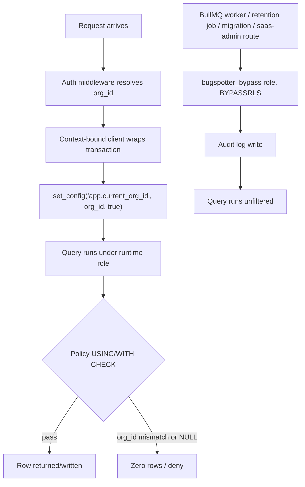

# Spec: RLS Slice 1 — ADR and rollout spec for Postgres row-level security

Linked issue: Refs #451
ADR: docs/adr/0045-postgres-row-level-security.md

**Files touched:** `docs/adr/0045-postgres-row-level-security.md`, `docs/adr/README.md`, `docs/specs/0451-rls-rollout-slices-2-7.md`
**Blocking prerequisites:** none

## Problem

Tenant isolation today is enforced entirely in application code — every repository method in `packages/backend/src/db/repositories` is responsible for adding its own `organization_id`/`project_id` filter, and nothing in `packages/backend/src/db/migrations` defines Postgres-level policies. The backend's runtime Postgres role is also the migration-owning role, so even if a policy were added naively it would be silently bypassed (table owners bypass RLS by default). A single missed `WHERE` clause in a repository or a new query path that forgets the filter is a cross-tenant data leak with no second line of defense. This slice produces no runtime change; it produces a ratified ADR (role model, context propagation, bypass paths, policy shape, table inventory, self-hosted behavior, rollout order) plus a spec that breaks the rollout in #450 into reviewable, ≤6-file slices, so that slices 2-7 can be implemented and reviewed independently without re-litigating the design each time.

## Out of scope

- Writing or applying any migration that adds `ENABLE ROW LEVEL SECURITY`, `CREATE POLICY`, or a new runtime role — that is slices 2-7.
- Any change to `packages/backend/src/db/client.ts`, `transaction.ts`, or repository call sites — slice 1 is docs-only.
- The intelligence service's database — it is a separate database per docs/adr/README.md Era 4 (ADR-0027/0028) and is out of scope for this platform-DB RLS effort entirely.
- Any component outside `bugspotter-public` (e.g. the SDK, extension, landing, MCP repos per the architecture index) — none of this issue's scope touches those repos.
- Deciding the final column/table list for every future migration — slice 1 inventories tables that exist **today**; new tables added after this ADR is accepted must follow its classification rules, not be retroactively added to the ADR.

## Constraints

1. The ADR must decide a role model (migration-owner role vs. a `NOSUPERUSER NOBYPASSRLS` runtime role) and specify the exact `GRANT`/`ALTER DEFAULT PRIVILEGES` needed on the `application`, `saas`, and `public` schemas — a table owner or superuser silently bypasses RLS, so this decision is a correctness precondition for every later slice.
2. Context propagation must use transaction-scoped `set_config('app.current_org_id', ..., true)` (the `true` "local" flag, not session-level `SET`) because `docker-compose.yandex.yml` fronts Postgres with PgBouncer in transaction-pooling mode on port 6432 — session-level `SET` would leak context across pooled connections reused by different requests.
3. The ADR must specify how `DatabaseClient` (`packages/backend/src/db/client.ts`) and the transaction helper (`packages/backend/src/db/transaction.ts`) obtain or wrap a context-bound client, without requiring every repository call site in `packages/backend/src/db/repositories` to change in the same slice (purely-additive rollout per CLAUDE.md). The exact shape of this wrapper is **ASSUMED, not verified** against the current contents of `client.ts`/`transaction.ts` (the source tree only lists paths, not exported symbols) — verify the actual exported class/function names before slice 2 implementation.
4. Every bypass path (BullMQ workers in `packages/message-broker/src/adapters/bullmq/worker-host.ts`, retention jobs, migrations, platform-admin routes) must be enumerated in the ADR with an explicit audit-log requirement for each. The exact route file backing platform-admin ("saas-admin") access is **ASSUMED, not verified** — not confirmed against `packages/backend/src/api/routes` contents; verify during the slice that implements the bypass-path tests.
5. Policy shape must specify `USING` + `WITH CHECK` on every policy (not `USING` alone, which permits cross-tenant writes), `FORCE ROW LEVEL SECURITY` so table owners are also subject to the policy unless using the designated bypass role, and fail-closed behavior when `app.current_org_id` is NULL or empty (deny, not allow-all).
6. The table inventory must classify every table reachable via `grep -liE "organization_id|project_id" packages/backend/src/db/migrations/*.sql` as org-scoped, project-scoped (resolving org via a join to `projects`), or global — each global classification needs a one-line reason in the ADR, not a bare label.
7. Each of slices 2-7 in the follow-up spec must touch 6 files or fewer and must only cause previously-working, same-tenant queries to continue succeeding — a slice may only start rejecting queries that were already cross-tenant bugs (per #450's constraint), never a same-tenant query that worked before.
8. The ADR's Testing Strategy section must name all 11 test categories from #450's Testing section explicitly by name (not summarized), so AC verification is a literal string match, not a judgment call.
9. Each slice 2-7 follow-up issue must be filed with its `Blocking prerequisites` field pointing at the slice(s) it depends on (at minimum, all of slices 2-7 depend on slice 1 / this ADR being `Accepted`).

## Acceptance criteria

- [ ] `docs/adr/0045-postgres-row-level-security.md` exists, follows the MADR shape (Context → Decision → Consequences → Alternatives) used by other entries in `docs/adr/README.md`, and its `Status:` field reads `Accepted` — verified by Test case A.
- [ ] The ADR contains a Mermaid flowchart diagram showing the request → transaction → `set_config` → policy-check flow, and a second path (or branch in the same diagram) for each bypass route — verified by Test case B.
- [ ] The ADR's Testing Strategy section contains all 11 test category names from #450 verbatim — verified by Test case C.
- [ ] `docs/adr/README.md` has a new Era 7 row for ADR-0045 (consistent with the existing table format) — verified by Test case D.
- [ ] `docs/specs/0451-rls-rollout-slices-2-7.md` exists and, for each of slices 2-7, lists: the files touched (with an explicit count ≤6), the migration file(s) it adds, and which named test categories from #450 it must add tests for — verified by Test case E.
- [ ] Each of the 6 follow-up GitHub issues for slices 2-7 is filed with a non-empty `Blocking prerequisites` field — this is a manual filing step tracked outside this repo's test suite, called out explicitly in Verification below since it cannot be grep-checked from a local clone.

## Changes

### `docs/adr/0045-postgres-row-level-security.md`

New file. Outline of required content (full prose is the deliverable of implementing this issue, not reproduced here):

```md
# ADR-0045: Postgres row-level security

Status: Accepted

## Context

<!-- app-only isolation today; runtime role = table owner; PgBouncer transaction pooling on :6432 -->

## Decision

1. Role model: migration-owner role (existing) retains DDL rights; new `bugspotter_runtime`
   role is NOSUPERUSER NOBYPASSRLS, granted via ALTER DEFAULT PRIVILEGES on `application`,
   `saas`, `public` schemas.
2. Context propagation: `set_config('app.current_org_id', $1, true)` issued as the first
   statement of every transaction obtained through the context-bound wrapper around
   DatabaseClient (packages/backend/src/db/client.ts) / transaction.ts. [ASSUMED, not
   verified against current exports — confirm exact wrapper shape before slice 2.]
3. Bypass model: BullMQ workers (worker-host.ts), retention jobs, migrations, and
   saas-admin routes [ASSUMED, not verified] run as a separate `bugspotter_bypass` role
   with BYPASSRLS, gated behind an audit-log write on every use.
4. Policy shape: USING + WITH CHECK on every policy, FORCE ROW LEVEL SECURITY, fail-closed
   on NULL/empty app.current_org_id.
5. Table inventory: <table classification, produced from the grep in Constraint 6>
6. Self-hosted mode: <single-tenant decision — RLS enabled with a fixed/default org_id,
   or RLS skipped entirely; must state which and why>
7. Rollout order: slice-by-slice plan referencing docs/specs/0451-rls-rollout-slices-2-7.md

## Testing Strategy

bypass-proof; per-table CRUD matrix; fail-closed; pooled-connection leak; concurrency;
role assertions; bypass paths; full-suite regression as the runtime role; self-hosted
mode; performance budget (p95 within 10%); migration up/down on prod-shaped data.

## Consequences

## Alternatives considered
```



### `docs/adr/README.md`

Add a row to the Era 7 table (append after the ADR-0044 row).

```md
| [0045](0045-postgres-row-level-security.md) | Postgres row-level security - role model, context propagation, bypass paths | public |
```

### `docs/specs/0451-rls-rollout-slices-2-7.md`

New file. Per-slice breakdown — the author filling this in during implementation must keep each slice ≤6 files and map it to named test categories from #450; the table below is the required shape, not final content.

```md
# Spec: RLS rollout, slices 2-7

| Slice | Scope                                            | Files (≤6)                                                      | Migration | Test categories (named per #450)                      |
| ----- | ------------------------------------------------ | --------------------------------------------------------------- | --------- | ----------------------------------------------------- |
| 2     | Runtime role + grants                            | migration file, docs/adr note                                   | 1 new     | role assertions, migration up/down                    |
| 3     | Context propagation wrapper                      | client.ts, transaction.ts, 1-2 callers                          | none      | pooled-connection leak, concurrency                   |
| 4     | Enable RLS + policies, org-scoped tables         | migration file(s)                                               | 1+ new    | per-table CRUD matrix, fail-closed, bypass-proof      |
| 5     | Project-scoped tables (resolve org via projects) | migration file(s)                                               | 1+ new    | per-table CRUD matrix, fail-closed                    |
| 6     | Bypass paths: workers, retention, saas-admin     | worker-host.ts, retention job file(s), saas-admin route file(s) | none      | bypass paths, full-suite regression as runtime role   |
| 7     | Self-hosted mode + perf validation               | config.ts, docs                                                 | none      | self-hosted mode, performance budget (p95 within 10%) |

Each slice's follow-up issue must set `Blocking prerequisites` to the prior slice(s).
```

## Tests

This slice is documentation-only; there is no application code and no vitest/jest suite to extend. Acceptance is verified by grep-based checks against the committed Markdown, run as shell commands (no mock/fixture changes apply — there is no test harness touching these files).

### Validation of `docs/adr/0045-postgres-row-level-security.md`

**Test case A — ADR has `Status: Accepted` (AC #1):**

```bash
grep -q '^Status: Accepted' docs/adr/0045-postgres-row-level-security.md
```

**Test case B — ADR contains a Mermaid diagram with both the main flow and a bypass path (AC #2):**

````bash
grep -q '```mermaid' docs/adr/0045-postgres-row-level-security.md
grep -q 'BYPASSRLS\|bypass' docs/adr/0045-postgres-row-level-security.md
````

**Test case C — Testing Strategy section names all 11 categories verbatim (AC #3):**

```bash
for cat in "bypass-proof" "per-table CRUD matrix" "fail-closed" "pooled-connection leak" \
           "concurrency" "role assertions" "bypass paths" "full-suite regression" \
           "self-hosted mode" "performance budget" "migration up/down"; do
  grep -qi "$cat" docs/adr/0045-postgres-row-level-security.md || echo "MISSING: $cat"
done
```

### Validation of `docs/adr/README.md`

**Test case D — Era 7 table has an ADR-0045 row (AC #4):**

```bash
grep -q '0045-postgres-row-level-security.md' docs/adr/README.md
```

### Validation of `docs/specs/0451-rls-rollout-slices-2-7.md`

**Test case E — spec enumerates slices 2-7 with files and test categories (AC #5):**

```bash
for slice in 2 3 4 5 6 7; do
  grep -q "| $slice |" docs/specs/0451-rls-rollout-slices-2-7.md || echo "MISSING slice $slice"
done
```

## Verification

````bash
git checkout main && git pull
grep -liE "organization_id|project_id" packages/backend/src/db/migrations/*.sql
grep -q '^Status: Accepted' docs/adr/0045-postgres-row-level-security.md
grep -q '0045-postgres-row-level-security.md' docs/adr/README.md
grep -q '```mermaid' docs/adr/0045-postgres-row-level-security.md
````

Filing the slice 2-7 follow-up issues with `Blocking prerequisites` set is a manual GitHub step and is not covered by the shell commands above — confirm each issue's metadata directly in the GitHub UI before closing #451.

Rollback: n/a — all changes are new/edited Markdown files in `docs/adr/` and `docs/specs/`; reverting the PR fully undoes this slice with no runtime or schema impact.
